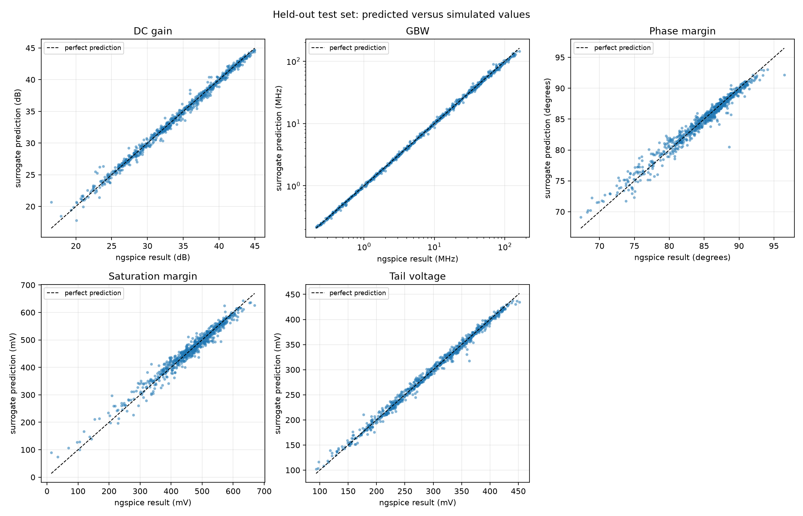
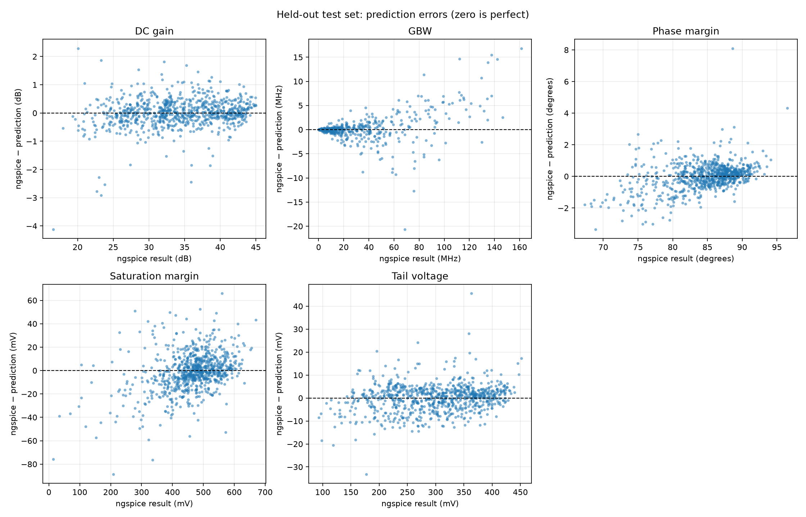
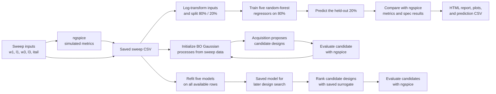
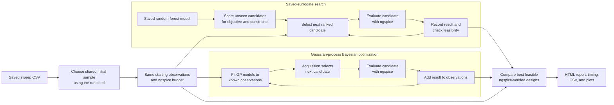

# analog-ml

Machine-learning-assisted sizing of analog circuits, using only open-source tools:
[ngspice](https://ngspice.sourceforge.io/) and the open
[SKY130](https://github.com/google/skywater-pdk) PDK.

The goal is to find out how far surrogate models and optimizers can go on real
analog design problems, starting with a deliberately simple circuit.
**Work in progress:** the data pipeline and first nominal surrogate are in
place; using the surrogate to search for better designs is next.

## What it does

1. **Simulates** thousands of sizings of a 5-transistor OTA with ngspice and
   extracts DC gain, gain-bandwidth product (GBW), phase margin (PM) and power.
2. **Classifies** every design against the requirements in
   [`specs.yaml`](specs.yaml): *invalid* (a transistor is out of saturation, or
   the tail node has no headroom), *valid but misses a spec*, or *passes*.
3. **Plots** where the passing designs live in the design space, explores how
   gain varies with channel length, and writes a summary table.
4. **Trains a first surrogate** to estimate nominal circuit metrics from the
   design variables, and checks its predictions on held-out sweep results.
   The evaluation is written as an HTML report with plots and a table of
   predicted-pass designs that failed ngspice verification.
5. *(next)* Uses the surrogate to search for promising designs, then verifies
   those designs with ngspice.


## The circuit and the design space

A 5-transistor OTA: NMOS differential pair (M1, M2), PMOS current-mirror load
(M3, M4) and an **ideal tail current source**. Open-loop AC response is measured
with the usual trick: DC unity feedback through a huge inductor, inverting
input grounded for AC by a huge capacitor.

| Variable | Meaning | Range (sampled log-uniformly) |
|---|---|---|
| `w1`, `l1` | input pair width, length | 7 to 50 µm, 0.15 to 2 µm |
| `w3`, `l3` | load pair width, length | 7 to 50 µm, 0.15 to 2 µm |
| `itail` | tail current | 100 nA to 100 µA |

Designs are drawn with a Sobol sequence (4096 points) so the space is covered
evenly. The load capacitance, performance requirements, and validity
thresholds are configured in [`specs.yaml`](specs.yaml); the data file records
the load capacitance used for each simulation.

Edit the requirements in `specs.yaml` and re-plot to reclassify existing data;
no re-simulation is needed. A design is *valid* if all four OTA transistors
meet the configured saturation-margin threshold and the tail node meets its
configured minimum voltage.

## Method notes

- **What the surrogate learns.** `train_surrogate.py` uses scikit-learn's
  `RandomForestRegressor`. It trains one model for each of five simulated
  outputs: gain, GBW, phase margin, saturation margin, and tail voltage. Power
  is calculated directly from the tail current, so it does not need a model.
- **How a random forest works.** Each decision tree learns simple split rules
  on the five inputs and predicts by averaging the training results in the
  matching leaf (the final region reached by those rules). By default, the
  forest averages 300 trees to make predictions less sensitive to any one
  tree. The inputs are converted to `log10` because the sweep varies them over
  multiplicative ranges; GBW is also learned in `log10` space.
- **How it is evaluated.** By default, the script holds out 20% of the sweep,
  trains on the other 80%, and compares predictions with ngspice results for
  those unseen rows. It reports mean absolute error (MAE), root mean squared
  error (RMSE), and R², alongside a simple mean-only prediction baseline.
  After this check, it trains a final model on all rows for later use. A random
  holdout measures performance within this sweep; it does not guarantee
  accuracy in new regions or near every spec boundary.
- **Trimmed model files.** Loading the full SKY130 typical corner makes ngspice
  parse about 30 device families and takes roughly 50 s per run. This project
  includes only the 1.8 V NMOS and PMOS models, which takes about 0.1 s per
  run and gave identical results on a test transistor.
- **Model binning.** SKY130 models are split into width/length bins. Measured
  steps in gm/Id across bin edges were a few tenths of a percent at most, so W
  and L are sampled continuously.
- **Serial simulation.** On the development machine, running ngspice in
  parallel was slower than a plain loop, so the sweep runs serially
  (about 8 minutes for 4096 designs).

## Limitations

- Ideal tail current source, so the tail device is not modelled.
- Typical corner and 27 °C only: no PVT, mismatch, noise or layout parasitics.
- The current sweep is nominal and does not model Monte Carlo variation or
  input offset; the surrogate trained from it cannot estimate offset.
- Lower tail currents limit achievable GBW, particularly with larger load
  capacitance.

## Reproduce

```bash
# system packages (Debian/Ubuntu)
sudo apt install -y python3-venv git ngspice

# Python environment
python3 -m venv .venv
source .venv/bin/activate
pip install -r requirements.txt

# Pre-built SKY130 PDK via ciel
ciel ls-remote --pdk-family=sky130            # list versions
ciel enable --pdk-family=sky130 <hash>        # version used for the results: <hash>

# Simulate, plot, write the table
python run_all.py --sweep

# Train and evaluate the surrogate using the saved sweep data
python run_all.py --surrogate
```

The surrogate command creates `reports/surrogate_report.html`, which you can
open in a browser. It includes a metric table (average prediction errors and
a simple baseline), plots comparing predictions with ngspice on held-out
designs, an error plot, and a table of predicted passes that failed simulation.
`reports/surrogate_test_predictions.csv` contains the inputs and actual and
predicted values for every held-out design. These files are generated locally
and are not tracked by git. The plots below are a snapshot of the current
4,096-row sweep; rerun `python run_all.py --surrogate --docs` to refresh them
after changing the data.

In the predicted-versus-simulated plots, each dot is one test design and dots
closer to the dashed diagonal mean more accurate predictions. GBW uses
logarithmic axes. The error plots show `ngspice result − prediction`; zero
means no error. MAE is the average absolute error, RMSE emphasizes larger
errors, and R² compares the model with a mean-only prediction. The
classification table is important for design search: a predicted pass is
only a candidate, and must still be checked with ngspice. This first model
uses nominal sweep data only; it cannot estimate Monte Carlo variation or 3σ
input offset.




### Surrogate training flow



In the diagram, the held-out 20% (the default) is used only to evaluate
predictions, not to fit those evaluated models. The final saved model is then
retrained using the full dataset. Bayesian optimization is a separate
Gaussian-process model initialized from known sweep simulations; it adds each
new ngspice result as an observation. It does not retrain or overwrite the
saved random-forest model. The test fraction and number of trees can be
changed with `--test-size` and `--trees` when running
`python train_surrogate.py --help`.

### Benchmarking the saved model

The training report's held-out results use simulations already in the sweep
CSV. To benchmark the already-trained model on new configurations instead,
run only:

```bash
source .venv/bin/activate
python3 benchmark_surrogate.py
```

This does not run a sweep or train a model. `benchmark_surrogate.py` loads the
existing `data/ota5t_surrogate.joblib` model and `data/ota5t_sobol.csv` training
data, samples 100 new log-uniform transistor configurations within the sweep
ranges, excludes configurations found in the training CSV, runs ngspice
through `src/ota5t.py`, and asks the saved model to predict gain, GBW, and
phase margin for each one. The training CSV is read only to avoid benchmarking
on designs the model has already seen.

The benchmark writes three files to `reports/`:

| File | Contents |
|---|---|
| `surrogate_benchmark.html` | Browser-friendly summary, valid-only accuracy, validity-flag results, and per-design comparisons |
| `surrogate_benchmark.csv` | Machine-readable per-design results |
| `surrogate_benchmark_summary.json` | Aggregate errors, run counts, and timing/speedup figures |

Open `reports/surrogate_benchmark.html` in a browser to inspect the results.
ngspice marks a design valid only when both transistor saturation margin and
tail voltage pass the configured thresholds. Accuracy errors and speed
comparisons are reported only for those valid designs. Invalid designs remain
in the per-design report with both ngspice and surrogate validity flags; their
gain, GBW, and phase-margin errors are left blank. The report also shows how
well the surrogate predicts validity. Model loading is timed separately and
excluded from speedup. Use `--n` to change the number of configurations and
`--seed` to reproduce a sample. The saved model must have been trained from
the sweep CSV supplied by `--training-data` (the default). The sweep and
training commands documented under [Reproduce](#reproduce) are only needed if
those input files do not already exist or you intentionally want to
regenerate the model.

### Optimizing designs with Bayesian optimization

`optimize_ota.py` compares two constrained searches with the same initial
sweep observations and ngspice evaluation budget: a search ranked by your
saved random-forest surrogate, and GP Bayesian optimization. The saved model
scores a large set of unseen candidates; GP BO fits Gaussian processes to the
sweep observations and updates them with each new ngspice result. The saved
random-forest model is not retrained or replaced. GP is retained as a useful
comparison because its uncertainty-aware expected-improvement acquisition
works differently from ranking designs by the saved model's predictions.

### Optimization flow



Both searches start from the same seeded sample and receive the same number
of new ngspice evaluations. The saved-surrogate search ranks a fixed pool of
unseen candidates; Bayesian optimization updates its Gaussian processes after
each simulation. Both methods' reported best designs are verified against
ngspice, and the report separates search-computation time from simulation
time.

Choose and edit objectives and constraints in
[`optimization_scenarios.yaml`](optimization_scenarios.yaml), then run:

```bash
source .venv/bin/activate
python3 optimize_ota.py --scenario minimize_power
```

The supplied scenarios minimize power while meeting the current specs,
maximize GBW while meeting gain/phase-margin/validity requirements, and
minimize power with a higher GBW target. To explore a power–GBW Pareto
trade-off, add power-minimization scenarios with different minimum GBW values
and compare their best feasible designs. Constraints in the YAML use the same
units as the sweep CSV: Hz for GBW, volts for saturation margin and tail
voltage, and watts for power. Feasibility and the reported best designs are
always checked against ngspice results, not just BO predictions.

By default each method receives 200 new ngspice evaluations after sharing 128
existing sweep observations. Change the budget or seed with `--iterations`
and `--seed`; `--help` lists all options. A seed determines the random initial
sweep subset and candidate sampling, so different seeds test whether results
depend on those choices. The script writes per-evaluation CSV, a JSON summary,
an HTML comparison, design-space plots, and an optimization-progress plot
under `reports/`. The report separates optimization computation from
ngspice evaluation time. In the plots, green means all scenario constraints
passed in ngspice and red means at least one failed. The comparison displays
power in µW, GBW in MHz, and voltage margins in mV; CSV and JSON retain the
original units. Multiple seeds provide a useful robustness check but are not a
statistical guarantee.

## Scripts

| File | Role |
|---|---|
| `run_all.py` | One command for the whole pipeline: sweep, plots, table. Options: `--sweep`, `--surrogate`, `--docs` |
| `specs.yaml` | Requirements, validity thresholds and test conditions |
| `sweep_ota.py` | Simulates the design points and writes `data/ota5t_sobol.csv` |
| `plot_results.py` | Four figures in `reports/` |
| `report_sweep.py` | HTML tables in `reports/` |
| `train_surrogate.py` | Trains and evaluates nominal metric models; writes an HTML report and plots to `reports/`, and a model to `data/` |
| `benchmark_surrogate.py` | Compares the saved model with fresh ngspice runs on new designs; writes HTML, CSV, and JSON reports |
| `optimization_scenarios.yaml` | Configurable objectives and constraints for design optimization |
| `optimize_ota.py` | Compares saved-surrogate-guided optimization with same-budget GP Bayesian optimization and ngspice verification |
| `try_ota.py` | Smoke test: simulates one design in about 0.1 s |
| `src/ngspice_backend.py` | Model includes and the function that runs ngspice in a scratch folder |
| `src/ota5t.py` | OTA netlist, metric extraction and `evaluate()` |
| `src/specs.py` | Reads `specs.yaml` and classifies designs |
| `src/tables.py` | Unit conversion and HTML table helpers |
| `src/plotting.py` | Plot style and log-axis helper |
| `sims/` | First single-transistor experiments |

`data/` and `reports/` are generated and not tracked by git. The figures shown
above are copied to `docs/` with `python run_all.py --docs`.
Surrogate training and scenario-driven Bayesian optimization are implemented.

## Data and licensing

Only open-source models and tools are used. The repository contains no
proprietary PDK data.
