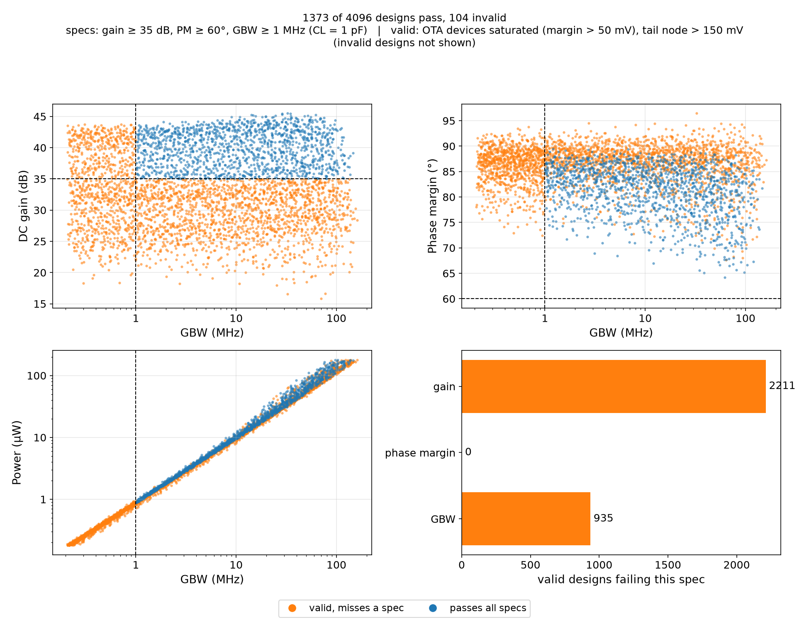
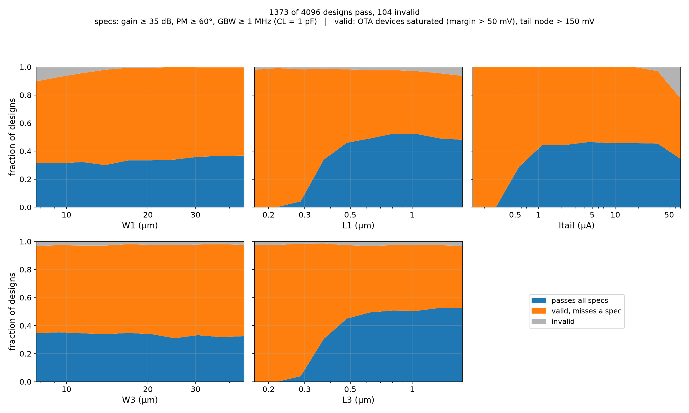
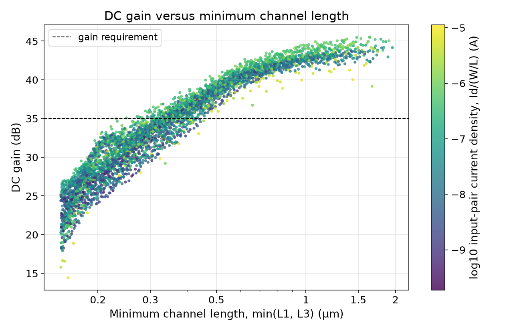

# analog-ml

Machine-learning-assisted sizing of analog circuits, using only open-source tools:
[ngspice](https://ngspice.sourceforge.io/) and the open
[SKY130](https://github.com/google/skywater-pdk) PDK.

The goal is to find out how far surrogate models and optimizers can go on real
analog design problems, starting with a deliberately simple circuit.
**Work in progress:** the data pipeline and first nominal surrogate are in
place; using the surrogate to search for better designs is next.

## What it does

1. **Simulates** thousands of sizings of a 5-transistor OTA with ngspice and
   extracts DC gain, gain-bandwidth product (GBW), phase margin (PM) and power.
2. **Classifies** every design against the requirements in
   [`specs.yaml`](specs.yaml): *invalid* (a transistor is out of saturation, or
   the tail node has no headroom), *valid but misses a spec*, or *passes*.
3. **Plots** where the passing designs live in the design space, explores how
   gain varies with channel length, and writes a summary table.
4. **Trains a first surrogate** to estimate nominal circuit metrics from the
   design variables, and checks its predictions on held-out sweep results.
5. *(next)* Uses the surrogate to search for promising designs, then verifies
   those designs with ngspice.





## The circuit and the design space

A 5-transistor OTA: NMOS differential pair (M1, M2), PMOS current-mirror load
(M3, M4) and an **ideal tail current source**. Open-loop AC response is measured
with the usual trick: DC unity feedback through a huge inductor, inverting
input grounded for AC by a huge capacitor.

| Variable | Meaning | Range (sampled log-uniformly) |
|---|---|---|
| `w1`, `l1` | input pair width, length | 7 to 50 µm, 0.15 to 2 µm |
| `w3`, `l3` | load pair width, length | 7 to 50 µm, 0.15 to 2 µm |
| `itail` | tail current | 100 nA to 100 µA |

Designs are drawn with a Sobol sequence (4096 points) so the space is covered
evenly. The load capacitance, performance requirements, and validity
thresholds are configured in [`specs.yaml`](specs.yaml); the data file records
the load capacitance used for each simulation.

Edit the requirements in `specs.yaml` and re-plot to reclassify existing data;
no re-simulation is needed. A design is *valid* if all four OTA transistors
meet the configured saturation-margin threshold and the tail node meets its
configured minimum voltage.

## Method notes

- **Trimmed model files.** Loading the full SKY130 typical corner makes ngspice
  parse about 30 device families and takes roughly 50 s per run. This project
  includes only the 1.8 V NMOS and PMOS models, which takes about 0.1 s per
  run and gave identical results on a test transistor.
- **Model binning.** SKY130 models are split into width/length bins. Measured
  steps in gm/Id across bin edges were a few tenths of a percent at most, so W
  and L are sampled continuously.
- **Serial simulation.** On the development machine, running ngspice in
  parallel was slower than a plain loop, so the sweep runs serially
  (about 8 minutes for 4096 designs).

## Limitations

- Ideal tail current source, so the tail device is not modelled.
- Typical corner and 27 °C only: no PVT, mismatch, noise or layout parasitics.
- The current sweep is nominal and does not model Monte Carlo variation or
  input offset; the surrogate trained from it cannot estimate offset.
- Lower tail currents limit achievable GBW, particularly with larger load
  capacitance.

## Reproduce

```bash
# system packages (Debian/Ubuntu)
sudo apt install -y python3-venv git ngspice

# Python environment
python3 -m venv .venv
source .venv/bin/activate
pip install -r requirements.txt

# Pre-built SKY130 PDK via ciel
ciel ls-remote --pdk-family=sky130            # list versions
ciel enable --pdk-family=sky130 <hash>        # version used for the results: <hash>

# Simulate, plot, write the table
python run_all.py --sweep

# Train and evaluate the surrogate using the saved sweep data
python run_all.py --surrogate
```

## Scripts

| File | Role |
|---|---|
| `run_all.py` | One command for the whole pipeline: sweep, plots, table. Options: `--sweep`, `--surrogate`, `--docs` |
| `specs.yaml` | Requirements, validity thresholds and test conditions |
| `sweep_ota.py` | Simulates the design points and writes `data/ota5t_sobol.csv` |
| `plot_results.py` | Four figures in `reports/` |
| `report_sweep.py` | HTML tables in `reports/` |
| `train_surrogate.py` | Trains and evaluates nominal metric models; writes metrics to `reports/` and a model to `data/` |
| `try_ota.py` | Smoke test: simulates one design in about 0.1 s |
| `src/ngspice_backend.py` | Model includes and the function that runs ngspice in a scratch folder |
| `src/ota5t.py` | OTA netlist, metric extraction and `evaluate()` |
| `src/specs.py` | Reads `specs.yaml` and classifies designs |
| `src/tables.py` | Unit conversion and HTML table helpers |
| `src/plotting.py` | Plot style and log-axis helper |
| `sims/` | First single-transistor experiments |

`data/` and `reports/` are generated and not tracked by git. The figures shown
above are copied to `docs/` with `python run_all.py --docs`.
Surrogate training is implemented; using it to optimize designs is still
planned.

## Data and licensing

Only open-source models and tools are used. The repository contains no
proprietary PDK data.
